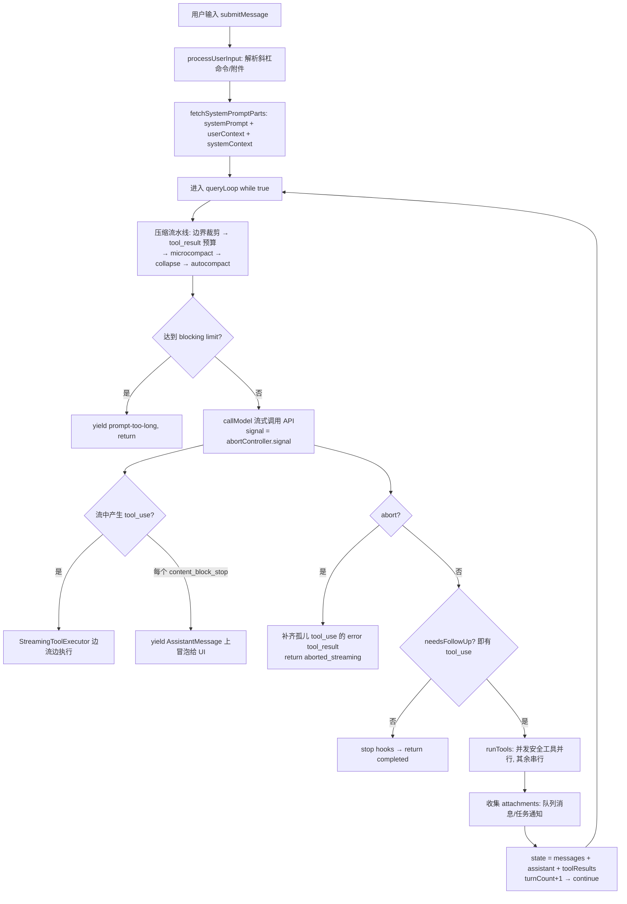

# 02 · Agent 循环、思考（Thinking）与任务编排

> 基于 Claude Code 2.1.88 恢复源码（`src/`）分析。本文回答：**Agent 主循环长什么样、extended thinking 如何处理、子代理如何 spawn 与汇总、上下文如何压缩、取消机制如何贯穿全局。**

---

## 1. 三层架构总览

```
┌─────────────────────────────────────────────────────────────┐
│ 入口层    REPL.tsx（交互式） / QueryEngine.ts（SDK/headless） │
│           每次用户输入 = 一次 submitMessage()                │
├─────────────────────────────────────────────────────────────┤
│ 循环层    query.ts :: query() → queryLoop()   while(true)   │
│           上下文压缩 → LLM 流式调用 → 工具执行 → 下一轮        │
├─────────────────────────────────────────────────────────────┤
│ API 层    services/api/claude.ts                            │
│           withRetry 包装 + 按 content-block 流式 yield        │
└─────────────────────────────────────────────────────────────┘
```

**核心形态：一切皆 async generator。** 从用户输入到最终结果之间的所有事件（流式 delta、assistant 消息、tool_result、attachment、compact 边界）都通过 `yield` 逐层向上冒泡。

| 层级 | 函数 | 位置 | 职责 |
|---|---|---|---|
| L0 | `QueryEngine.submitMessage()` | `src/QueryEngine.ts:209` | 一次用户输入的完整生命周期；会话级消息数组跨 turn 持久 |
| L1 | `query()` / `queryLoop()` | `src/query.ts:219` / `:241` | 核心 agentic loop，`while(true)` 每圈 = 一次 API 往返 |
| L2 | `deps.callModel()` | `src/services/api/claude.ts` | 单次流式 API 调用，每个 content block 结束时 yield 一条 AssistantMessage |
| L3 | `runTools()` / `StreamingToolExecutor` | `src/services/tools/` | 工具并发执行 |

---

## 2. 主循环：一个 turn 的完整流程



### 2.1 循环的可变状态（`src/query.ts:204`）

```ts
type State = {
  messages: Message[]                       // 累积的消息历史
  toolUseContext: ToolUseContext            // abortController、options、agentId
  autoCompactTracking: AutoCompactTrackingState | undefined
  maxOutputTokensRecoveryCount: number      // max_tokens 恢复次数（上限 3）
  hasAttemptedReactiveCompact: boolean      // 防止 413→compact→413 死循环
  maxOutputTokensOverride: number | undefined
  stopHookActive: boolean | undefined
  turnCount: number
}
```

每轮结束整体替换：`state = { ...state, messages: nextMessages, turnCount: +1 }`。

### 2.2 终态原因枚举

`completed` / `blocking_limit` / `model_error` / `prompt_too_long` / `aborted_streaming` / `aborted_tools` / `stop_hook_prevented` / `max_turns`。

### 2.3 四个关键细节

1. **每个 content block 一条 AssistantMessage**：API 流的 `content_block_stop` 时构造并 yield；随后的 `message_delta` 把真实 `usage`/`stop_reason` 直接 mutate 到最后一条消息上。
2. **循环是否继续不看 `stop_reason`**（注释明言其不可靠），而看流式过程中实际收集到的 `toolUseBlocks.length > 0`。
3. **消息追加顺序不变量**：下一轮 = `[...messages, ...assistantMessages(本轮), ...toolResults]`，tool_result 不与普通 user 消息交错。
4. **取消不变量**：abort 后必须先用合成 error tool_result **补齐所有未配对的 tool_use**（API 硬性要求每个 tool_use 有配对 tool_result），再退出循环。

---

## 3. Extended / Interleaved Thinking

### 3.1 配置形态（`src/utils/thinking.ts:10`）

```ts
type ThinkingConfig =
  | { type: 'adaptive' }                        // 自适应，无显式 budget
  | { type: 'enabled'; budgetTokens: number }   // 经典 budget 模式
  | { type: 'disabled' }
```

### 3.2 请求侧组装规则（`src/services/api/claude.ts:1596-1630`）

- 模型支持 thinking 且未禁用 → 带 `thinking` 参数（adaptive 或 budget）。
- **`budget_tokens` 必须 `< max_tokens`**（组装时 clamp：`min(maxOutputTokens - 1, budget)`）。
- **thinking 开启时不发送 temperature**（API 要求 temperature=1）。
- Interleaved thinking 只需带 beta header `interleaved-thinking-2025-05-14`，API 即允许 thinking 与 text/tool_use 交错；客户端把 thinking block 当普通 content block 透传即可。

### 3.3 回传 API 的三条"巫师规则"（`src/query.ts:151-163`）

1. 含 thinking block 的请求必须开启 thinking（`max_thinking_length > 0`）。
2. thinking block 不能是 block 序列的最后一个。
3. 在一个 assistant 轨迹内（单轮；若含 tool_use 则包括其 tool_result 及后续 assistant 消息）必须**原样保留 thinking block（含 signature）**。

唯一主动修改场景：模型 fallback 时签名是模型绑定的，重放给另一个模型会 400，此时 `stripSignatureBlocks()` 整体剥除。

### 3.4 成本控制

- **子代理默认禁用 thinking**（`runAgent.ts:679-684`）。
- fork 子代理继承父配置 + 父工具数组 + 父系统提示词 → **逐字节相同的前缀 → prompt cache 命中**。

---

## 4. 子 Agent：递归调用同一个 query()

### 4.1 本质

子代理不是新架构，而是**在同一进程里再跑一个完整 `query()`**（`src/tools/AgentTool/runAgent.ts:748`）：

```ts
for await (const message of query({
  messages: initialMessages,        // 只有 prompt（fork 时可选继承父历史）
  systemPrompt: agentSystemPrompt,  // 子代理自己的系统提示词
  canUseTool,                       // 与父共享（权限提示冒泡到主终端）
  toolUseContext: subagentContext,  // 隔离的上下文
  maxTurns,
})) { /* 写入 subagents/ 目录的 sidechain 转录 */ }
```

### 4.2 隔离边界

| 维度 | 隔离方式 |
|---|---|
| 消息历史 | 完全独立数组；父**只看最终文本**，中间消息不进父历史 |
| abortController | 同步子代理共享父的；**异步子代理用全新不链接的控制器**（ESC 取消主线程时后台代理应存活） |
| UI 回调 | 子代理全部置空（进度经 onProgress → `agent_progress` 消息流入 UI） |
| agentId | 新建；通知按 agentId 路由 |

### 4.3 结果回主对话的两条路径

1. **同步**：取子代理最后一条含 text 的 assistant 消息 → 作为 AgentTool 的 tool_result。
2. **异步**：完成时生成 `<task-notification>` XML 进全局队列 → 主循环下一轮工具执行后作为 attachment 注入；父代理可读 outputFile 取完整输出。

### 4.4 任务抽象（`src/Task.ts`）

```ts
type TaskStatus = 'pending'|'running'|'completed'|'failed'|'killed'
type Task = { name: string; type: TaskType
  kill(taskId, setAppState): Promise<void> }   // kill = abortController.abort()
```

---

## 5. 上下文压缩流水线

每轮循环入口按此顺序执行（`src/query.ts:365-467`）：

```
messages
  └─ getMessagesAfterCompactBoundary()  // 只取最后一个 compact 边界之后
  └─ applyToolResultBudget()            // 超大 tool_result 落盘替换为预览
  └─ microcompact()                     // 按 tool_use_id 替换旧工具结果
  └─ contextCollapse()                  // 投影折叠视图
  └─ autocompact()                      // 全量摘要压缩（最后手段）
```

**Token 计量**（`src/utils/tokens.ts:226`）：从尾部找最近一条带真实 `usage` 的 assistant 消息，取 `input + cache_creation + cache_read + output`，加上其后消息的粗估值。

**阈值体系**（`src/services/compact/autoCompact.ts`）：

```ts
effectiveWindow      = contextWindow - min(maxOutputTokens, 20_000)
autoCompactThreshold = effectiveWindow - 13_000   // 触发自动压缩
blockingLimit        = effectiveWindow - 3_000    // 禁止发 API 请求
MAX_CONSECUTIVE_AUTOCOMPACT_FAILURES = 3          // 熔断
```

压缩本质是**fork 一个总结代理**：产出 `boundary 标记 + 摘要消息 + 恢复附件（最近文件/plan/任务状态）`，随后主循环用 post-compact 消息替换历史继续。

---

## 6. 取消机制：AbortController 层级

```
QueryEngine.abortController（interrupt() → abort()）
  └─ toolUseContext.abortController（每 turn 新建）
      ├─ StreamingToolExecutor.siblingAbortController (child)
      │    └─ 每个工具的 toolAbortController (child)   // 工具级取消
      ├─ 同步子代理: 共享父 controller
      └─ 异步子代理: 全新不链接 controller             // 后台任务独立存活
```

检查点：① 流式 API 期间 signal 传给 SDK；② 每个工具执行入口检查；③ 权限等待 Promise 在 abort 时立即 resolve 为取消；④ ESC 键优先 abort 当前 turn。

---

## 7. 可移植最小实现要点

### 7.1 五个核心抽象

```ts
// 1) 消息 = API 的 MessageParam + 少量本地元数据
// 2) 工具
type Tool = {
  name: string
  inputSchema: JSONSchema
  isConcurrencySafe(input): boolean
  call(input, ctx): Promise<unknown>
  checkPermissions?(input, ctx): Promise<'allow'|'deny'|'ask'>
}
// 3) 贯穿一切的上下文（服务定位器）
type ToolUseContext = { abortController: AbortController; options: {...}; agentId?: string }
// 4) 权限函数
type CanUseToolFn = (tool, input, ctx) => Promise<{behavior:'allow'|'deny'}>
// 5) 主循环 ≈ 100 行 async generator（见 mini-agent/src/agent.js）
```

### 7.2 必须守住的不变量

1. **每个 tool_use 必须有配对 tool_result** —— 取消/出错时用合成 error tool_result 补齐。
2. **thinking block 原样回传**（含 signature）；thinking 开启时不设 temperature；`budget_tokens < max_tokens`。
3. **消息追加顺序**：`[...old, ...assistant(本轮), ...toolResults]`。
4. **取消即不变量维护**：abort 后先补齐 tool_result 再退出。
5. **子代理 = 递归调用同一个 query()**：独立消息数组 + 新 agentId，只回传最终文本。
6. **压缩阈值按 API 真实 usage 计**，连续失败设熔断。

### 7.3 第一版可以砍掉的

流式期间执行工具、token budget 续推、reactive compact、worktree 隔离、sidechain 转录——这些都是优化层。第一版用「**流完再跑工具 + 简单全量摘要压缩**」即可（对应实现见 `tool/mini-agent/`）。
