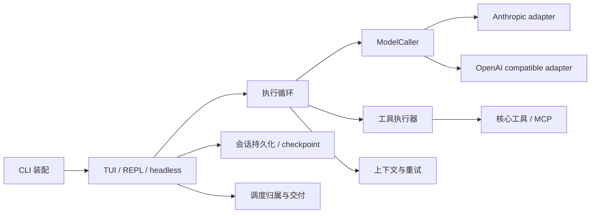

# 当前项目架构

> 更新：2026-10-02。此页是当前架构导航；旧版说明保存在 [历史架构快照](archive/202609-项目架构.md)。
> 领域术语见 [CONTEXT.md](../CONTEXT.md)，已接受的取舍见 [设计决策](architecture/decisions.md)。实际数量以 `npm run docs:sync` 为准。

## 一次请求的数据流

## 模块导航

| 范围 | 当前入口 | 责任 |
|---|---|---|
| CLI 装配 | [cli.ts](../src/cli.ts)、[cli-config.ts](../src/cli-config.ts)、[cli-tools.ts](../src/cli-tools.ts) | 配置、可信规则、工具与 UI 注入 |
| 会话初始化与恢复 | [cli-session.ts](../src/cli-session.ts) | 保留会话存储位置，原地替换对话和 live session id |
| 客户端 | [cli-repl.ts](../src/cli-repl.ts)、[tui/run.tsx](../src/tui/run.tsx) | 将用户输入与执行事件适配到终端 |
| 核心执行 | [agent-loop.ts](../src/agent-loop.ts)、[tool-executor.ts](../src/tool-executor.ts) | 流式响应、工具配对、取消、输入校验、权限与 hook |
| 模型适配 | [llm-adapter.ts](../src/llm-adapter.ts)、[anthropic-adapter.ts](../src/anthropic-adapter.ts) | 将内部消息转换为 provider 请求并归一流事件 |
| 模型能力与努力 | [model-metadata.ts](../src/model-metadata.ts)、[effort.ts](../src/effort.ts) | 窗口、输出上限、推理能力和 effort 的共用事实 |
| 系统提示 | [system-prompt.ts](../src/system-prompt.ts) | 静态前缀缓存与动态会话信息 |
| 上下文 | [context-pipeline.ts](../src/context-pipeline.ts)、[auto-compact.ts](../src/auto-compact.ts) | 工具结果回收、内容恢复与模型摘要 |
| 早启动与预取 | [streaming-tool-executor.ts](../src/streaming-tool-executor.ts)、[speculation.ts](../src/speculation.ts) | 串行屏障、只读预取与变更后失效 |
| 权限 | [permissions.ts](../src/permissions.ts)、[permission-policy.ts](../src/permission-policy.ts) | 禁止 / 审批规则、安全底线与权限模式 |
| Hook | [hooks.ts](../src/hooks.ts)、[hooks-config.ts](../src/hooks-config.ts) | 事件执行与指纹信任 |
| 工具目录 | [tools/registry.ts](../src/tools/registry.ts)、[tools/core-tools.ts](../src/tools/core-tools.ts) | 能力声明、输入 schema、结果格式与当前工具视图 |
| MCP | [mcp/index.ts](../src/mcp/index.ts)、[mcp/auth.ts](../src/mcp/auth.ts) | 连接、刷新、资源、授权和工具变化通知 |
| 委派 | [types.ts](../src/types.ts)、[subagents.ts](../src/subagents.ts)、[team.ts](../src/team.ts)、[workflow.ts](../src/workflow.ts) | 子上下文派生、权限继承、受限审批及并发 |
| 会话存储 | [session-memory.ts](../src/session-memory.ts)、[checkpoint.ts](../src/checkpoint.ts) | 快照、锁、损坏隔离、文件回退材料与回合关联 |
| 调度 | [cron-shared.ts](../src/tools/extended/cron-shared.ts)、[schedule-wakeup.ts](../src/tools/extended/schedule-wakeup.ts)、[scheduler.ts](../src/tools/extended/scheduler.ts)、[schedule-scope.ts](../src/tools/extended/schedule-scope.ts) | 工作区归属、会话归属、持久化、排队、取消和交付 |
| 磁盘扩展 | [disk-loader.ts](../src/utils/disk-loader.ts)、[frontmatter.ts](../src/utils/frontmatter.ts)、[disk-template.ts](../src/utils/disk-template.ts) | 共用扫描与模板展开；各来源自行注册 |
| TUI 状态与展示 | [tui/store.ts](../src/tui/store.ts)、[tui/App.tsx](../src/tui/App.tsx)、[tui/InputBox.tsx](../src/tui/InputBox.tsx) | 活动工具、流缓冲、overlay、输入和终端呈现 |
| 询问面板 | [PromptPanel.tsx](../src/tui/PromptPanel.tsx)、[Prompts.tsx](../src/tui/Prompts.tsx)、[permission-presentation.ts](../src/tui/permission-presentation.ts) | 统一开放布局、操作说明、编号选择、Tab 补充与自定义回答；权限补充先拒绝当前操作，再提交用户说明 |

## 必须成立的运行规则

1. 子代理保留父会话的权限规则；审批能力使用受限通道。Task、Agent、Team、Workflow 与 Fork Skill 均通过 `deriveSubContext` 构造上下文。
2. 一次 loop 解析一个有效 HookRunner：显式 loop hook 优先，否则使用工具上下文中的 hook，执行与生命周期事件共用它。
3. 工具调用先验证输入，再运行 PreToolUse、工具硬策略和系统权限，最后执行与 PostToolUse。只读调用也受禁止规则限制。
4. TUI 的动态 prompt builder 返回完整提示，包括会话目标；静态提示的兼容入口才补目标。
5. 会话文件、转录及 checkpoint 有稳定的存储位置；`/cd` 改工具工作区，不迁移这套会话材料。用户消息持久记录 checkpoint 归属，恢复和分叉按会话标识区分。
6. checkpoint 内容缺失或写入失败时报告不完整回退，保留历史供重试；Shell 修改仍不被追踪。
   旧版未持久保存回合标记的消息无法可靠重建关联，仍只回退对话。
7. durable 任务属于工作区；session-only cron、sleep 和 wakeup 同时属于会话。调度只交付当前工作区与会话可接收的任务。
8. 到期输入排队后仍保留任务身份；取消覆盖等待与排队状态，切换会话不会将旧输入送给新会话。
9. MCP 刷新同时更新注册表、稳定的执行数组和子代理工具集。`/tools` 读取当前目录。
10. 项目 LSP 配置需要内容指纹信任；协议失败／进程退出后清理并重启。URL 打开需要用户先确认；Windows 启动器不拼接 URL 到命令文本。
11. 跨项目 user memory 写入需要明确许可；所有记忆读改写使用跨进程锁。目标完成与暂停状态持久保存，恢复会话同时刷新提示与评估器状态。
12. 缺少计划审批渠道保持 plan 模式；机器输出根据最终 Terminal 分类，可恢复诊断不改变最终成功状态。

## 持久材料

| 材料 | 归属与位置 |
|---|---|
| 会话消息 | 会话存储工作区的 `.claude/sessions/<id>.json` |
| 转录 | 同一会话目录的 `<id>.transcript.jsonl` |
| 文件回退材料 | 会话存储工作区的 `.claude/checkpoints/<id>/`，内容寻址 blobs 与索引 |
| 持久定时任务 | 创建任务工作区的 `.claude/scheduled_tasks.json` |
| 长期记忆 | 项目 `.claude/memories.jsonl` 与 memory 索引；同仓库 worktree 共享。user 记忆在独立用户配置根 |
| 会话运行状态 | `.claude/session-runtime/<id>.json` 保存目标、会话任务、Team、结构化任务和后台输出；恢复的运行中任务标记中断 |
| 工作流缓存 | `.claude/workflow-runs/`，按会话与运行标识复用已完成且参数未变化的 worker 报告 |
| 内存状态 | read / change tracker、工作树切换栈和活进程仍按会话隔离；不能把历史状态当成复活的进程 |

## 验证与构建

v1.6.0 的新增入口：配置与指令在 [settings.ts](../src/settings.ts)、[project-instructions.ts](../src/project-instructions.ts)；工作树在 [worktrees.ts](../src/worktrees.ts)；当回合 Skill 权限与模型在 [scoped-execution.ts](../src/scoped-execution.ts)；持续目标和恢复在 [goal-runtime.ts](../src/goal-runtime.ts)、[session-runtime.ts](../src/session-runtime.ts)；通用 LSP 在 [language-servers.ts](../src/language-servers.ts)；自动化在 [headless.ts](../src/headless.ts)、[sdk.ts](../src/sdk.ts)、[Python SDK](../python/ccr_sdk.py)；共享预算在 [model-budget.ts](../src/model-budget.ts)。配置迁移与外部服务边界见 [升级日志](更新日志/20261002-comprehensive-upgrade.md)。

| 命令 | 实际行为 |
|---|---|
| `npm run build` | esbuild 按源文件转译为 ESM，输出 dist，不做类型检查 |
| `npm run typecheck` | tsc --noEmit，单独进行类型检查 |
| `npm test` | Vitest 收录 `.test.ts` 与 `.test.tsx` |
| `npm run test:coverage` | V8 覆盖率门禁 |
| `npm run check` | Biome 检查；不会自动写入 |
| `npm run smoke` | 构建与 CLI / TUI 启动退出冒烟 |
| `npm run docs:sync -- --check` | 校验数字、当前文档路径与验证口径 |

[CI](../.github/workflows/ci.yml) 使用 Node 24，在 Linux（ubuntu-latest）与 Windows（windows-latest）执行检查；项目最低要求 Node 22.22.1，本地通过结果不能代替 CI 状态。
